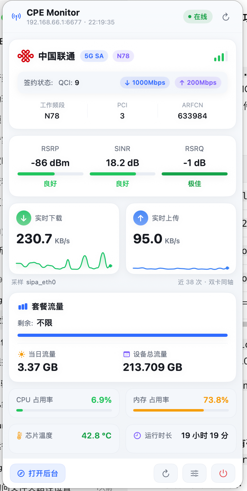
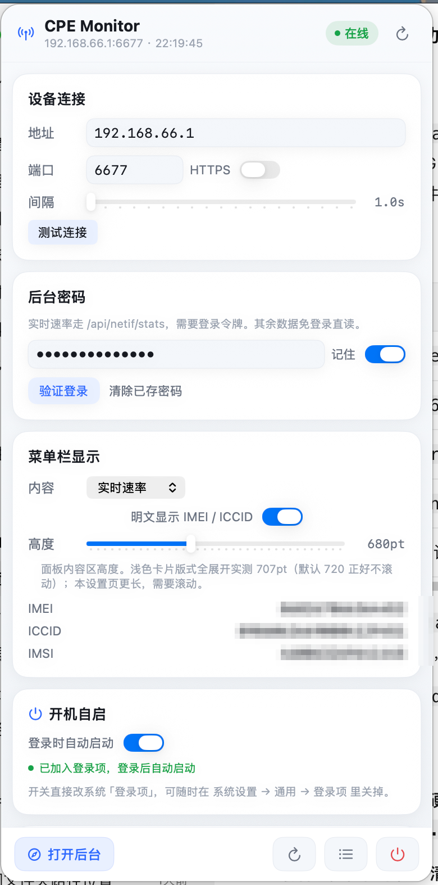
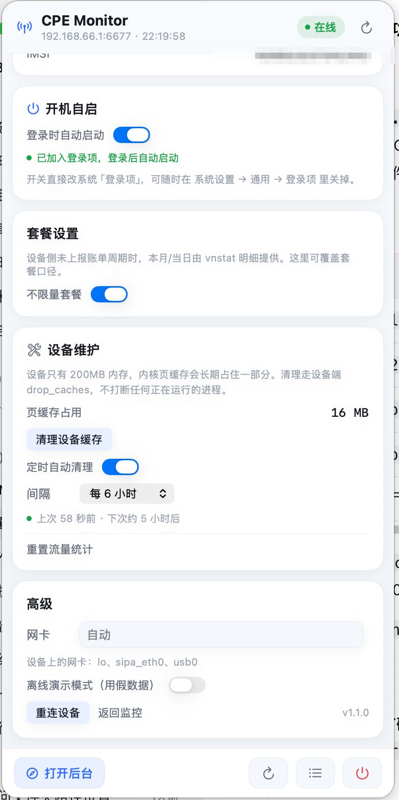

# CPE Monitor

macOS 菜单栏常驻的 5G CPE / 插卡路由器实时监控面板。
数据来自设备端 [UDX710-TOOLS](https://github.com/sunnyboy5/UDX710-TOOLS) 的 HTTP 接口，
开机即驻留菜单栏，点开一屏看完网络、信号、速率、流量与硬件状态。

纯 SwiftUI + SwiftPM，**不需要完整 Xcode**，只用 CommandLineTools 就能构建和打包。

<p align="center">
  
  
  
</p>

<p align="center"><sub>左：主面板　中／右：设置页（IMEI / ICCID / IMSI 已脱敏）</sub></p>

## 功能

| 模块 | 内容 | 接口 |
|---|---|---|
| 网络信息 | 运营商、网络模式（5G SA）、工作频段（n78）、QCI 等级、签约上下行 | `GET /api/info` |
| 无线信号 | RSRP / SINR / RSRQ，每项自动评级（极佳 / 良好 / 一般 / 较差）+ 进度条 | `GET /api/current_band` |
| 实时网速 | 实时下载 / 上传速率 + 折线波形（48 采样点滚动） | `POST /api/netif/stats` |
| 流量统计 | 套餐类型、本月已用（带占用进度条）、当日已用、累计 | `/api/get/set` + `vnstat` |
| 硬件状态 | CPU 占用、内存占用、芯片温度、运行时长 | `GET /api/info` |
| 设备维护 | 清理设备内核页缓存、重置流量统计，可设定时自动清理 | `POST /api/clear_cache` + `POST /api/set/total` |

菜单栏标题可选：仅图标 / 实时速率 / 信号强度 / 芯片温度 / CPU / 内存。

## 安装

从 [Releases](../../releases) 下载 DMG，挂载后把 `CPE Monitor.app` 拖进「应用程序」。

App 是 ad-hoc 签名（未公证），首次打开会被 Gatekeeper 拦一次，二选一放行：

- 系统设置 → 隐私与安全性 → 「仍要打开」
- 或终端执行 `xattr -dr com.apple.quarantine "/Applications/CPE Monitor.app"`

首次启动会自动开一个窗口并停在设置页，填好设备地址和后台密码即可。

## 自己构建

```bash
./build.sh                 # 产出 dist/CPE Monitor.app（本机架构，开发用）
./build.sh --universal     # arm64 + x86_64 通用二进制（分发必须用这个）
./build.sh --install       # 构建并安装到 /Applications
./build.sh --run           # 构建后直接运行
./build.sh --demo          # 独立窗口 + 演示数据启动，没设备也能看界面
```

环境要求：macOS 14+、CommandLineTools。构建脚本使用 `swift build --disable-sandbox` ——
部分受限环境下 SwiftPM 编译 manifest 时调用的 `sandbox-exec` 会被系统拦截，跳过它才编得过。

## 鉴权

UDX710-TOOLS 的 `is_auth_whitelist` 放行了两个核心接口：

- `GET /api/info` —— 免登录
- `GET /api/current_band` —— 免登录

只有实时速率（`/api/netif/stats`）、流量明细、设备维护等需要 `Bearer` 令牌。
App 在设置里保存一次后台密码（存钥匙串），自动登录，并在 401 时静默重登。

> 两个容易踩的点：
> 1. `/api/info` 的 `downlink_rate` / `uplink_rate` 来自 `get_qos_info()`，是 **QCI 签约速率**，
>    不是实时吞吐。真正的实时速率只在 `/api/netif/stats`。
> 2. `/api/netif/stats` 只有在 `POST /api/netif/monitor` 开启该网卡监听后才有数据。
>    App 会自动挑网卡（`sipa_eth0` → `eth0` → `usb0` → `rmnet0` → `wwan0` → `wlan0`）并开启监听。

## 设备维护

设备只有 200MB 内存，内核页缓存（`/proc/meminfo` 的 `Cached`，即 `/api/info` 的 `cached_ram`）
会长期占住一部分。设置页「设备维护」里能直接看这个数，并提供两个动作：

| 动作 | 接口 | 说明 |
|---|---|---|
| 清理设备缓存 | `POST /api/clear_cache` | 设备端执行 `sync` + `echo 3 > /proc/sys/vm/drop_caches`，只释放页缓存，不打断任何进程 |
| 重置流量统计 | `POST /api/set/total`（空 body） | **不可撤销**：设备端删除并重建 `vnstat.db`，历史统计全部归零，因此做了二次确认 |

「定时自动清理」可设 15 分钟 ~ 24 小时，默认关闭。它挂在轮询的慢循环上，不另起计时器。
有个细节值得留意：**时间戳在发请求之前推进** —— 清理失败也不会立刻重试，否则慢循环每 16 秒
重来一次，等于拿 `drop_caches` 反复砸设备。`lastAutoClearAt` 不落盘，App 重启后首次触发会立刻清一次。

## 设置项

| 项 | 说明 |
|---|---|
| 地址 / 端口 | 设备 IP。UDX710 通用版默认 `6677`，SZ50 版默认 `80` |
| 刷新间隔 | 1–10 秒，默认 2 秒（对应快循环；流量明细走慢循环） |
| 菜单栏显示 | 仅图标 / 实时速率 / 信号强度 / 芯片温度 / CPU / 内存 |
| 后台密码 | 存钥匙串，用于换令牌拿实时速率 |
| 网卡 | 留空自动挑选，也可手动指定 |
| 套餐口径 | 设备未上报账单周期时，本月 / 当日取自 vnstat 明细 |
| 设备维护 | 清缓存、重置统计、定时自动清理 |
| 开机自启 | 登录时自动启动，直接改系统「登录项」 |

## 真机实测记录

实测设备：`192.168.66.1:6677`，aarch64 UDX710，内核 4.14.98，vnStat 2.11 beta1。
下面几条都只有接上真机才会暴露：

| 现象 | 真正原因 | 处理 |
|---|---|---|
| `/api/shell` 总返回「命令不能为空」 | Foundation 的 `JSONSerialization` 默认把 `/` 转义成 `\/`，而设备端 mongoose 的 `mg_json_get_str` **不认这个转义**，解析失败就当空命令 | 编码时加 `.withoutEscapingSlashes` |
| `vnstat --json m,d` 报 `No interface matching "m,d"` | vnStat 2.x 的 `--json` **不接受逗号分隔的多个模式**，逗号会被当成接口名 | 拆成 `--json m` / `--json d` 两次串行调用 |
| 实时速率一直读到 0 | `vnstat -l` 是新 fork 出来的实时进程，冷启动时还没有采样点 | 开启监听后等 4 秒再采用读数（期间显示「采样中」） |
| `/api/info` 的 `network_band` 是 `N/A` | 该字段在通用版固件上不上报 | 频段以 `/api/current_band` 的 `Data.band`（如 `N78`）为准 |
| 「签约下行」显示成 1000000 Mbps | `downlink_rate` / `uplink_rate` 的单位是 **kbps**，当 Mbps 用差了 1000 倍 | 统一换算后显示（1000000 / 200000 kbps → 1000 / 200 Mbps） |
| 「当日已用」停在昨天 | `vnstatd` 守护进程没运行，数据库不再写入 | 见下节 |

> 另一个容易误判的点：`/api/shell` 一定要**串行**调用。设备端是单线程 Mongoose，
> shell 又是同步阻塞执行，并发发两个请求会有一个拿不到结果。

### 关于 vnstatd

`vnstat -l` 只负责实时速率；**历史与当日统计靠 `vnstatd` 写库**。设备上如果没跑，
数据库会停在最后一天。启动方式：

```bash
/home/root/6677/vnstatd --noadd --config /home/root/6677/vnstatd.conf -d
```

没启动时 App 不会假装数据是今天的 —— 「当日已用」会标注实际归属日期（例如 `9-11`）。

## 命令行参数

| 参数 | 作用 |
|---|---|
| `--window` | 以独立窗口启动（默认只驻留菜单栏，需要点顶部图标展开） |
| `--mock` | 演示模式，用假数据跑界面，不连设备 |
| `--live` | 强制走真机（覆盖已保存的演示模式开关） |
| `--host` / `--port` | 临时指定设备地址，**不写入配置** |
| `--password` | 临时指定后台密码，**不写入钥匙串** |
| `--auto-clear` | 临时打开定时清理（不写盘），用于验证自动清理链路 |
| `--login-item status\|on\|off` | 登录项注册链路诊断（不点界面验证开机自启） |
| `--verbose` | 启动后向 stderr 打印窗口与连接诊断 |

```bash
# 独立窗口 + 演示数据
open "dist/CPE Monitor.app" --args --window --mock

# 独立窗口 + 连真机（地址临时覆盖，不影响已保存配置）
open "dist/CPE Monitor.app" --args --window --live \
  --host 192.168.1.1 --port 6677 --password admin
```

命令行给的参数都是一次性覆盖，不会污染 UserDefaults 与钥匙串。

## 开发与调试

### 协议仿真服务

没有设备在手时，用内置的仿真服务配合自检模式验证整条链路（字段名严格照抄 `handlers.c`）：

```bash
# 1. 起仿真服务
python3 tools/mock_server.py 16677

# 2. 接口自检：逐项验证解码、鉴权、网卡挑选、速率、流量明细
dist/CPE\ Monitor.app/Contents/MacOS/CPEMonitor \
  --selftest --host 127.0.0.1 --port 16677 --password admin

# 3. 轮询引擎巡检：真实引擎跑 N 秒，观察速率曲线与状态
dist/CPE\ Monitor.app/Contents/MacOS/CPEMonitor \
  --watch --host 127.0.0.1 --port 16677 --password admin --seconds 16

# 4. 维护接口联调：清缓存 / 重置统计，跑完自退
dist/CPE\ Monitor.app/Contents/MacOS/CPEMonitor \
  --probe-maintenance --host 127.0.0.1 --port 16677 --password admin
```

连真机时把 `--host` 换成设备 IP。`--watch` 用 `persist: false` 构造配置，
不会覆盖已保存的连接设置和钥匙串。加 `--mock` 可脱离设备、用演示数据跑一遍引擎。

### 界面渲染诊断

原生菜单栏面板既没法用 `screencapture` 截（需要屏幕录制授权），也不好直接展示，
所以内置了三条渲染通道，专门用来「看见」真实版式：

```bash
# 1. 纯 SwiftUI 离屏渲染。快，但渲染不了 ScrollView / NSViewRepresentable
dist/CPE\ Monitor.app/Contents/MacOS/CPEMonitor \
  --probe --live --host 192.168.66.1 --port 6677 --password admin --out /tmp/cpe-probe

# 2. 真实 NSWindow 渲染。走 AppKit 绘制路径，能验证 ScrollView
dist/CPE\ Monitor.app/Contents/MacOS/CPEMonitor \
  --probe-window --live --host 192.168.66.1 --port 6677 --password admin --out /tmp/cpe-win

# 3. 自动点开真实菜单栏面板：量尺寸 + 截图 + 滚到底再截一张
dist/CPE\ Monitor.app/Contents/MacOS/CPEMonitor \
  --diag-panel --live --host 192.168.66.1 --port 6677 --password admin --out /tmp/cpe-panel
```

`--diag-panel` 通过 `performClick` 触发菜单栏图标，能拿到 `MenuBarExtraWindow` 的真实尺寸，
并报告滚动视图的 document / 视口尺寸，用来确认下面的模块滚得到：

```
[diag] ✅ 面板尺寸 = 384x820pt class=MenuBarExtraWindow<AnyView>
[diag]   document=707pt 视口=720pt 可滚动=false
[diag] 已滚到底部 y=0
```

`--out` 指定输出目录，`--probeDelay` 指定等数据到位的秒数（默认 4，看流量明细建议 20）。

## 构建与分发

```bash
./package.sh                                    # 产出 DMG + ZIP + SHA256
./package.sh --sign "Developer ID Application: 名字 (TEAMID)"    # 正式签名
./package.sh --sign "..." --notarize cpe-monitor # 签名 + 公证（需先配好凭据）
./package.sh --no-build                          # 复用现有 dist/ 只打包
```

产出在 `dist/`：

| 文件 | 说明 |
|---|---|
| `CPE Monitor 1.1.0.dmg` | 主分发件。挂载后是「App + Applications 软链 + 使用说明.txt」 |
| `CPE Monitor 1.1.0.zip` | 备用件，网络不稳时更好传 |
| `SHA256.txt` | 校验值，可用 `shasum -a 256` 核对 |

**一定要打通用二进制。** `package.sh` 内部走的是 `build.sh --universal`。
只编 arm64 的话，Intel Mac 会直接「打不开」（Rosetta 只做 x86_64 → arm64，不反向翻译），
脚本会在检测到单架构时警告。App 体积 4.4MB / DMG 1.4MB。

**关于 Gatekeeper：** ad-hoc 签名（`codesign --sign -`）只能保证本机运行，
别人下载后 `spctl` 会判定 rejected：

```
$ spctl -a -vv "CPE Monitor.app"
CPE Monitor.app: rejected
```

| 路线 | 做法 | 使用者体验 |
|---|---|---|
| 无账号（默认） | 直接发 DMG | 双击被拦 → 系统设置 → 隐私与安全性 → 「仍要打开」；或 `xattr -dr com.apple.quarantine "/Applications/CPE Monitor.app"` |
| 有账号（$99/年） | `--sign "Developer ID Application: ..." --notarize <profile>` | 双击直接打开，无任何提示 |

公证前先存一次凭据（只需一次）：

```bash
xcrun notarytool store-credentials cpe-monitor \
  --apple-id "你的AppleID" --team-id "TEAMID" --password "App专用密码"
```

`package.sh --notarize cpe-monitor` 会自动 `notarytool submit --wait` → `stapler staple`，
App 和 DMG 各公证一次。签名用 `--options runtime`（hardened runtime），这是公证的硬前提。

### 首次启动引导

App 是 `LSUIElement`（不占 Dock、不自动弹窗），新用户装完只看到菜单栏一个图标，
很容易以为装失败。所以**第一次启动会自动开一个窗口并停在设置页**，让他先填设备地址。
标记存在 `ui.didWelcome`，之后启动就安静了。诊断模式（`--probe` / `--selftest` / `--watch`）
和 `--no-welcome` 都不会触发。

## 开机自启

设置 → **开机自启** 一键开关，走系统「登录项」（macOS 13+ 的 `SMAppService.mainApp`），
不往 `~/Library/LaunchAgents` 写 plist，也不需要 sudo：

- 开关状态每次进设置页都重新读系统真实值（用户可能在系统设置里改过）
- 被系统拦下（`requiresApproval`）时会给一个「打开『登录项』设置」的直达按钮
- 关掉即干净卸载，不留残留

```bash
# 命令行走一遍注册链路（不点界面也能验证）
dist/CPE\ Monitor.app/Contents/MacOS/CPEMonitor --login-item status
dist/CPE\ Monitor.app/Contents/MacOS/CPEMonitor --login-item on
dist/CPE\ Monitor.app/Contents/MacOS/CPEMonitor --login-item off
```

> ⚠️ 构建脚本用的是 **ad-hoc 签名**（`codesign --sign -`），每次重新构建签名都会变，
> 系统可能认不出旧的登录项记录 —— 表现是「开关开着但重启后没起来」，**重新拨一次开关即可**。
> 更稳的做法是先 `./build.sh --install` 装到 `/Applications` 再开启，
> 工程目录里的 `dist/` 一移动，登录项就失效了。

## 目录结构

```
cpe-monitor/
├── Package.swift
├── build.sh                      # SwiftPM 构建 + 手工组装 .app（含资源拷贝、通用二进制）
├── package.sh                    # 分发打包：DMG + ZIP + SHA256，支持签名 / 公证
├── Resources/Info.plist          # LSUIElement、图标、ATS 放开明文 HTTP
├── Resources/AppIcon.icns        # 应用图标（由 tools/make_icon.swift 生成）
├── Resources/Carriers/*.png      # 四家运营商真图标（200×200 透明 PNG）
├── preview/                      # 界面截图（真机实拍 + 离屏渲染 + 静态预览）
├── tools/make_icon.swift         # 画 AppIcon.icns（渐变圆角方 + 天线符号）
├── tools/使用说明.txt            # 随 DMG 发给最终用户的说明
├── tools/mock_server.py          # UDX710-TOOLS 协议仿真服务
└── Sources/CPEMonitor/
    ├── CPEMonitorApp.swift       # @main + MenuBarExtra + 独立窗口模式（AppDelegate）
    ├── Core/
    │   ├── Models.swift          # 数据模型，字段对齐 handlers.c
    │   ├── APIClient.swift       # HTTP 客户端 + 自动重登
    │   ├── MonitorEngine.swift   # 快慢双循环轮询引擎
    │   ├── Settings.swift        # UserDefaults 配置（支持不落盘模式）
    │   ├── LaunchAtLogin.swift   # 开机自启（SMAppService）+ --login-item 诊断
    │   ├── Keychain.swift        # 密码存储
    │   ├── Rating.swift          # 信号评级与归一化
    │   ├── Formatters.swift      # 速率 / 字节 / 时长格式化
    │   ├── MockData.swift        # 演示数据
    │   ├── Probe.swift           # 离屏渲染诊断通道
    │   └── SelfTest.swift        # 命令行自检与巡检
    ├── Theme/Theme.swift         # 全部配色集中在此，换肤只改这一个文件
    └── UI/
        ├── DashboardView.swift
        ├── SettingsView.swift
        ├── Panels.swift          # 五个模块面板
        └── Components.swift      # 进度条 / 波形 / 评级标签 / 运营商角标等
```

## 配色

集中定义在 `Sources/CPEMonitor/Theme/Theme.swift`，浅色卡片风。
**全局锁定浅色外观**（`NSApp.appearance = .aqua`），否则系统切深色时会出现深色滚动条与原生控件：

| 用途 | 值 |
|---|---|
| 页面底 / 卡片 / 卡片内嵌浅底 | `#F1F4F8`（顶部 `#F8FAFD` 渐变）/ `#FFFFFF` / `#F5F7FB` |
| 卡片描边 / 投影 | `#E5E9F0` 0.5pt / 黑色 5%、r6、y2 |
| 正文 / 次要 / 弱化 | `#171A21` / `#6A7280` / `#9BA3B0` |
| 强调（蓝） | `#2F6BFF`，浅底 `#E9F0FF` |
| 下载 / 上传 | `#16C46A` / `#3B82F6` |
| 评级递进 | 极佳 `#16A34A` → 良好 `#22C55E` → 一般 `#F59E0B` → 较差 `#EF4444` |

## 运营商图标

角标用真图标，放在 `Resources/Carriers/`，由 `build.sh` 拷进 `.app/Contents/Resources/Carriers/`，
运行时按 `Bundle.main` 读取并按 `CarrierBrand` 映射：

| 文件 | 运营商 | 匹配关键字 |
|---|---|---|
| `unicom.png` | 中国联通 | `联通` |
| `telecom.png` | 中国电信 | `电信` |
| `mobile.png` | 中国移动 | `移动` |
| `broadcast.png` | 中国广电 | `广电` |

图标为 200×200 带透明通道 PNG，直接贴在白卡上，不需要白底。资源缺失时自动退回
「色块 + 简称」角标（`CarrierBrand.tint`），不会出现空白框。换图标只需替换这四个文件后重新构建。

## 许可证

MIT
